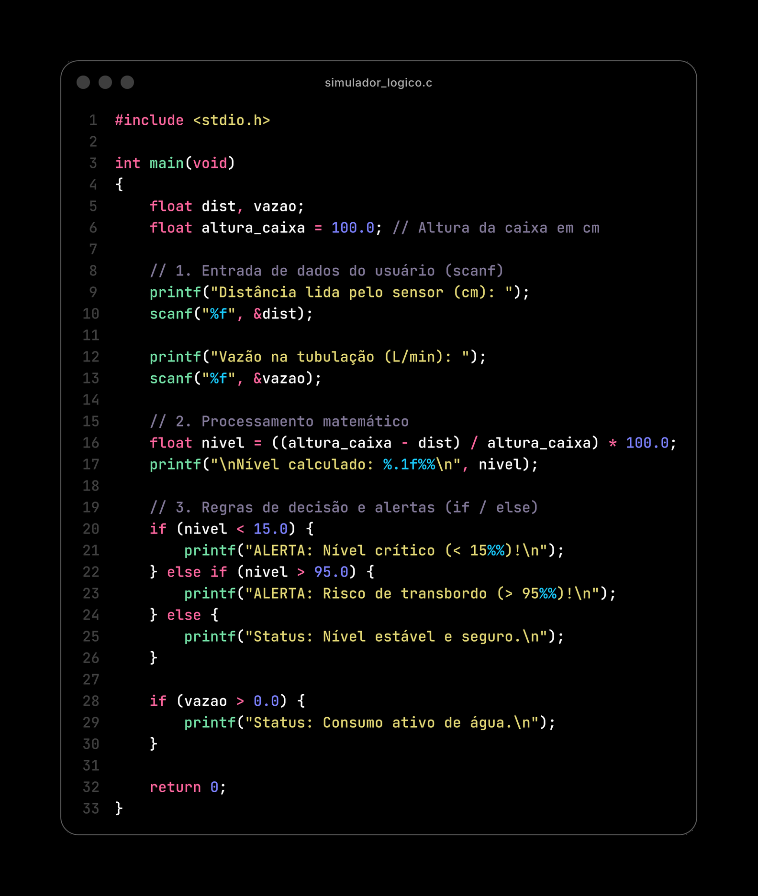
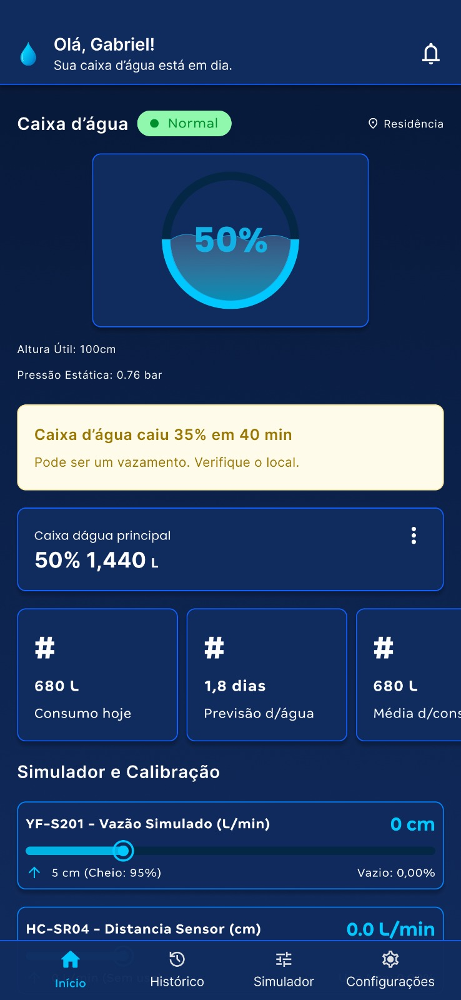

<div align="center">

  🇧🇷 **[Versão em Português](README.pt-BR.md)**
  <br>

  # 💧 HidroCheck | Integrative Project I - Fatec Taubaté

  ### **IoT System Prototyping for Residential Water Management (1st Semester ADS - 2026.2)**

  [](src/simulador_logico.c)
  [](docs/assets/prototipo_figma.jpeg)
  [](index.html)
  [](js/app.js)
  [](https://fatectaubate.cps.sp.gov.br/)

  <br>

  🌐 **[Open Live Web Prototype](https://hidrocheck.lucasresende.com/)** · 📄 **[Open Presentation Slides (PDF)](docs/presentation/Apresentacao_Projeto_Integrador.pdf)** · 🔍 **[View Research & Prompts](docs/research/README.md)**

</div>

---

## 🎯 About the Project & Our Team

This repository gathers our group's work for the **Integrative Project I (Projeto Integrador I)** course in the 1st semester of the **Systems Analysis and Development (ADS)** degree at **Fatec Taubaté**.

- **Team Members:**
  - Abner de Melo Rodrigues
  - Esmyrna Cristine Guimarães de Morais
  - Felipe Montes Santos Salgado
  - Gabriel Moreira Gonçalves
  - Lucas Alberto dos Santos Resende
  - Matheus Vinicius Silva
- **Faculty Advisor:** Prof. Luís Felipe Féres Santos
- **Presentation Slides (PDF):** **[`Apresentacao_Projeto_Integrador.pdf`](docs/presentation/Apresentacao_Projeto_Integrador.pdf)**

### What is the Project Idea?
In most Brazilian homes, rooftop water tanks rely only on a traditional mechanical float valve. The problem is that a mechanical float gives zero visibility into how much water is actually stored inside the tank. Because of that, residents only find out there is a street water outage when the tank runs completely dry, or only notice a stuck float or pipe leak when water overflows or the monthly water bill arrives much higher than usual.

### What We Did in This 1st Semester
Since we are in our **1st semester of college**, our goal was not to buy and solder physical sensors on a workbench yet (hardware assembly is planned for future semesters). Our work in this first semester focused on laying the groundwork for the project:
1. Researching household water waste and comparing the price of existing monitors on the market.
2. Choosing affordable electronic parts (keeping the budget under **R$ 150**) to solve the problem.
3. Defining how the system works and what rules it uses to trigger alerts.
4. Programming a **basic terminal simulator in C** using what we learned in class.
5. Creating **visual screen prototypes** to show how a resident would check their water tank on a phone or computer.

---

## 💻 Project Prototypes

This repository holds the different prototypes we created to represent our idea:

### 1. Logic Simulator in C ([`src/simulador_logico.c`](src/simulador_logico.c))
This is our 33-line terminal program built using the basic **Input, Processing, and Output** concepts from our *Algorithms and Programming Logic* class:
- Asks the user to type on the keyboard (`scanf`) the distance read by the sensor to the water (`cm`) and the pipe flow rate (`L/min`).
- Calculates the remaining water percentage in the tank: `nivel = ((altura_caixa - dist) / altura_caixa) * 100.0`.
- Uses `if / else` decision structures to print alerts for critical low level (`< 15%`), overflow risk (`> 95%`), normal level, and active water consumption.

<div align="center">
  
</div>

---

### 2. Single-Screen Prototype in Figma ([`docs/assets/prototipo_figma.jpeg`](docs/assets/prototipo_figma.jpeg))
A single-screen visual prototype designed in **Figma** to plan how the mobile app would look for the resident. It shows:
- The current water tank level in percentage (`50%` / `1,440 L`).
- A warning card if the water level drops too fast (*"Water tank dropped 35% in 40 min - possible leak"*).
- Simple cards showing today's water usage, an estimate of how many days the water will last (`1.8 days`), and average usage.
- Sliders at the bottom of the screen to test and simulate the `YF-S201` and `HC-SR04` sensors.

<div align="center">
  
</div>

---

### 3. Interactive Web Prototype (Generated with AI for Visualization)
In addition to our C program and the Figma screen, we used AI tools (**Google Antigravity** and **Canva**) to generate an interactive web version of the dashboard (`index.html`, `css/`, and `js/`).
- **What is the purpose of this web version?** Since we are still in our 1st semester, it was created with AI strictly so we could have a clickable version in the browser to visualize how a complete system (with charts, alerts, and live sensor sliders) could look in future semesters.
- **Try it live:** Visit **[hidrocheck.lucasresende.com](https://hidrocheck.lucasresende.com/)** (or via [GitHub Pages](https://lucasresendev.github.io/hidrocheck/)) and click **⚡ Acesso Rápido (Demonstração)** (or log in with username `fatec` and password `fatec`).

<div align="center">
  
</div>

---

## 🔌 Selected Hardware Parts & System Rules

### Hardware Components (< R$ 150)
During our market research, we saw that industrial systems cost over R$ 1,500 and cheaper commercial monitors (R$ 300 to R$ 600) only measure static water level. Because of that, we picked 3 affordable parts so we can measure both **water level** and **pipe flow**:

| Component | What It Does |
| :--- | :--- |
| **NodeMCU ESP8266** | Low-power microcontroller board with built-in Wi-Fi that receives the sensor readings and runs the percentage math. |
| **Sensor `HC-SR04` (or `JSN-SR04T`)** | Ultrasonic sensor mounted on the top lid of the tank that measures the distance to the water using sound waves without touching the water. |
| **Flow Sensor `YF-S201` (1/2")** | Sensor installed inline in the pipe to measure water flowing through in liters per minute (`L/min`). |

### Data Flow & Alert Rules
We planned the data flow in 3 simple steps: **1. Physical Reading (Sensors)** $\rightarrow$ **2. Processing (% Math on the board)** $\rightarrow$ **3. Web Display (Dashboard & Alerts)**.

| Status | Condition | System Alert |
| :--- | :--- | :--- |
| 🔴 **Critical** | `Level < 15%` | **Almost Empty Tank Alert** (risk of running out of water) |
| 🟢 **Normal** | `15% to 95%` | **Stable & Safe Status** |
| 🟠 **Risk** | `Level > 95%` | **Overflow Risk Alert** (warns if the float valve gets stuck) |
| 🌙 **Night Leak** | Continuous flow at night | If water keeps flowing through the pipe late at night when nobody is using it, flags a **possible leak** |

---

## 📚 How We Applied Our 1st-Semester Subjects

This project brought together what we studied across our 1st-semester classes:

- **Software Engineering I:** Gathering system requirements and planning a realistic project scope.
- **Algorithms & Programming Logic:** Using variables, math formulas, and conditional structures (`if / else`) in our C program.
- **Computer Architecture & Organization:** Understanding hardware basics, how sensors work physically, and how the microcontroller processes data.
- **Operating Systems:** Input/Output (I/O) concepts and basic network communication.
- **Communication & Expression:** Writing our technical report and preparing our classroom presentation.
- **English I:** Reading English terms in C programming, research materials, and hardware manuals.

---

## 🔍 Research & Prompts We Used

Before picking the hardware parts and putting our slides together, we organized a research step using **Google NotebookLM** (combining Software Engineering books and project methodology papers) and wrote 3 prompts to run in-depth searches on **Google Gemini** and **Qwen** about household water waste, existing market monitors, and how the sensors work.

👉 We documented step by step how we did this research and saved all **3 original prompts** in: **[`docs/research/README.md`](docs/research/README.md)**.

---

## 📂 Folder Organization

```text
hidrocheck/
├── src/
│   └── simulador_logico.c                     # 33-line C code for the terminal simulator
│
├── docs/
│   ├── presentation/
│   │   └── Apresentacao_Projeto_Integrador.pdf # PDF with the 14 slides presented by the group
│   ├── assets/
│   │   ├── prototipo_figma.jpeg               # Screenshot of the screen designed in Figma
│   │   ├── simulador_c_slide11.png            # Image of the C code used in the slides
│   │   └── mockup_canva_slide12.png           # Dashboard illustration used in the slides
│   └── research/
│       ├── README.md                          # Research notes and prompts used (English)
│       └── README.pt-BR.md                    # Research notes and prompts used (Portuguese)
│
├── CNAME                                      # Custom domain configuration (GitHub Pages)
├── index.html                                 # Web prototype page (GitHub Pages)
├── css/                                       # CSS files for the web prototype
├── js/                                        # JS files for the web prototype
├── README.md                                  # Main documentation (English)
└── README.pt-BR.md                            # Main documentation (Portuguese)
```

---

## 🚀 How to Run on Your Computer

### 1. Compile and Run the C Program (Terminal)
With `gcc` (or `clang`) installed, run:

```bash
mkdir -p dist && gcc -Wall src/simulador_logico.c -o dist/simulador_logico && ./dist/simulador_logico
```

### 2. Open the Web Prototype Locally
Simply open `index.html` directly in your browser, or start a simple local server:

```bash
# Start local server on port 4173
python3 -m http.server 4173
```
Then open `http://localhost:4173/` in your browser.

---

<div align="center">
  1st-Semester ADS Academic Project — <b>Fatec Taubaté (2026.2)</b> 🚀
</div>
