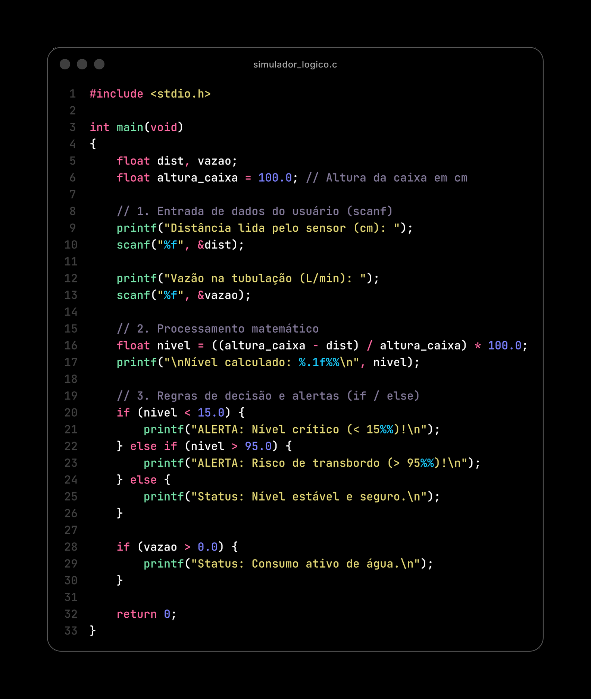
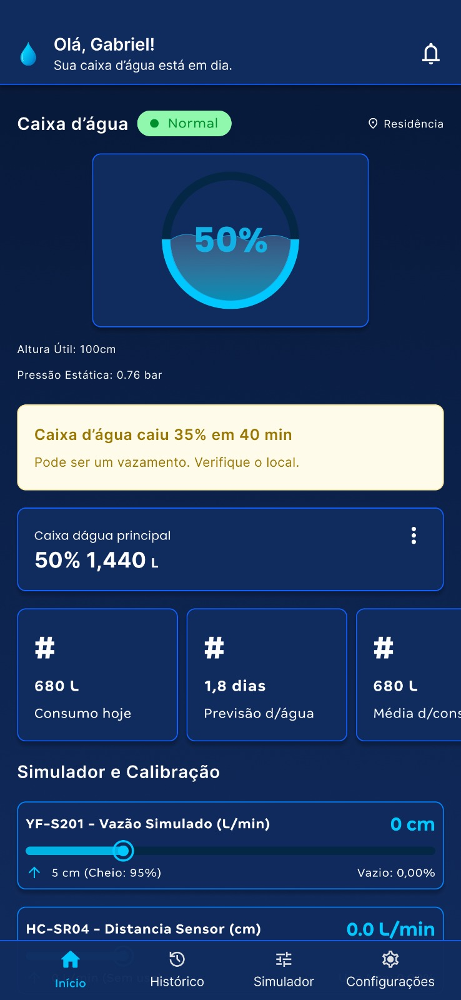

<div align="center">

  🇺🇸 **[English Version](README.md)**
  <br>

  # 💧 HidroCheck | Projeto Integrador I - Fatec Taubaté

  ### **Prototipagem de Sistema IoT para Gestão Hídrica Residencial (1º Semestre ADS - 2026.2)**

  [](src/simulador_logico.c)
  [](docs/assets/prototipo_figma.jpeg)
  [](index.html)
  [](js/app.js)
  [](https://fatectaubate.cps.sp.gov.br/)

  <br>

  🌐 **[Ver Protótipo Web ao Vivo](https://hidrocheck.lucasresende.com/)** · 📄 **[Abrir Slides da Apresentação (PDF)](docs/presentation/Apresentacao_Projeto_Integrador.pdf)** · 🔍 **[Ver Pesquisas e Prompts](docs/research/README.pt-BR.md)**

</div>

---

## 🎯 Sobre o Projeto e Nossa Equipe

Este repositório reúne o trabalho desenvolvido pelo nosso grupo para a disciplina de **Projeto Integrador I** no 1º semestre de **Análise e Desenvolvimento de Sistemas (ADS)** na **Fatec Taubaté**.

- **Integrantes do Grupo:**
  - Abner de Melo Rodrigues
  - Esmyrna Cristine Guimarães de Morais
  - Felipe Montes Santos Salgado
  - Gabriel Moreira Gonçalves
  - Lucas Alberto dos Santos Resende
  - Matheus Vinicius Silva
- **Professor Orientador:** Prof. Luís Felipe Féres Santos
- **Apresentação em Sala (PDF):** **[`Apresentacao_Projeto_Integrador.pdf`](docs/presentation/Apresentacao_Projeto_Integrador.pdf)**

### Qual é a Ideia do Projeto?
Na maioria das casas brasileiras, a caixa d'água funciona apenas com uma boia mecânica comum. O problema é que essa boia não mostra quanta água tem guardada lá dentro. Por isso, o morador só descobre que faltou água na rua quando a caixa já esvaziou por completo, ou só percebe que a boia travou e houve vazamento quando a água transborda pelo "ladrão" e a conta do mês chega alta.

### O que Fizemos neste 1º Semestre
Como ainda estamos no **1º semestre da faculdade**, nosso objetivo não foi comprar e soldar os sensores físicos na bancada (essa montagem física fica para os próximos semestres). O nosso trabalho neste semestre foi planejar a base do projeto:
1. Pesquisar o problema de desperdício de água e comparar o preço dos medidores que já existem no mercado.
2. Escolher peças eletrônicas baratas (orçamento abaixo de **R$ 150**) que resolvam o problema.
3. Definir como o sistema vai funcionar e quais regras ele vai usar para dar os avisos.
4. Programar um **simulador básico em linguagem C** no terminal usando o que aprendemos em aula.
5. Criar **protótipos visuais de tela** para mostrar como o morador acompanharia a caixa d'água pelo celular ou computador.

---

## 💻 Os Protótipos do Projeto

Neste repositório estão guardados os diferentes protótipos que criamos para representar a nossa ideia:

### 1. Simulador Lógico na Linguagem C ([`src/simulador_logico.c`](src/simulador_logico.c))
É o programa de terminal de 33 linhas que fizemos aplicando os conceitos básicos de **Entrada, Processamento e Saída** da matéria de *Algoritmos e Lógica de Programação*:
- Pede para o usuário digitar no teclado (`scanf`) a distância lida pelo sensor até a água (em `cm`) e a vazão na tubulação (em `L/min`).
- Calcula a porcentagem de água restante na caixa: `nivel = ((altura_caixa - dist) / altura_caixa) * 100.0`.
- Usa estruturas de decisão (`if / else`) para mostrar alertas de nível crítico (`< 15%`), risco de transbordo (`> 95%`), nível estável e aviso de consumo ativo de água.

<div align="center">
  
</div>

---

### 2. Protótipo de Tela no Figma ([`docs/assets/prototipo_figma.jpeg`](docs/assets/prototipo_figma.jpeg))
Um protótipo visual de uma única tela desenhado no **Figma** para planejar como seria o aplicativo no celular do morador. Ele mostra:
- O nível atual da caixa d'água em porcentagem (`50%` / `1.440 L`).
- Um aviso de alerta caso o nível caia rápido demais (*"Caixa d'água caiu 35% em 40 min - pode ser um vazamento"*).
- Cartões informando o consumo do dia, a previsão de quantos dias a água vai durar (`1,8 dias`) e a média de consumo.
- Barras na parte de baixo da tela para simular os sensores `YF-S201` e `HC-SR04`.

<div align="center">
  
</div>

---

### 3. Protótipo Web Interativo (Gerado com IA para Visualização)
Além do nosso código em C e da tela desenhada no Figma, usamos ferramentas de IA (como o **Google Antigravity** e o **Canva**) para gerar uma versão web interativa do painel (`index.html`, `css/` e `js/`).
- **Qual é o objetivo dessa versão web?** Como ainda estamos no 1º semestre, ela foi criada com IA apenas com o intuito de termos algo navegável para visualizar como o sistema completo (com gráficos, alertas e simulação de sensores em tempo real) poderia funcionar na prática no futuro.
- **Para ver funcionando ao vivo:** Basta acessar **[hidrocheck.lucasresende.com](https://hidrocheck.lucasresende.com/)** (ou pelo [GitHub Pages](https://lucasresendev.github.io/hidrocheck/)) e clicar no botão **⚡ Acesso Rápido (Demonstração)** (ou entrar com usuário `fatec` e senha `fatec`).

<div align="center">
  
</div>

---

## 🔌 Peças Escolhidas e Regras do Sistema

### Componentes de Hardware (< R$ 150)
Na nossa pesquisa de mercado, vimos que sistemas industriais custam mais de R$ 1.500 e que os medidores comerciais mais baratos (R$ 300 a R$ 600) medem apenas o nível parado da água. Por isso, escolhemos 3 componentes baratos para conseguir medir tanto o **nível** quanto a **vazão**:

| Componente | O que ele faz |
| :--- | :--- |
| **NodeMCU ESP8266** | Placa microcontroladora com Wi-Fi integrado e baixo consumo de energia que recebe as leituras e faz os cálculos. |
| **Sensor `HC-SR04` (ou `JSN-SR04T`)** | Sensor ultrassônico que fica na tampa da caixa d'água e mede a distância até a água usando ondas de som, sem precisar encostar na água. |
| **Sensor de Vazão `YF-S201` (1/2")** | Sensor instalado no cano para medir a passagem de água em litros por minuto (`L/min`). |

### Fluxo do Dado e Regras de Alerta
O funcionamento foi pensado em 3 passos simples: **1. Leitura Física (Sensores)** $\rightarrow$ **2. Processamento (Cálculo de % na placa)** $\rightarrow$ **3. Exibição Web (Painel e Alertas)**.

| Situação | Condição | Alerta do Sistema |
| :--- | :--- | :--- |
| 🔴 **Crítico** | `Nível < 15%` | **Alerta de Caixa Quase Vazia** (risco de acabar a água da casa) |
| 🟢 **Normal** | `15% a 95%` | **Status Estável e Seguro** |
| 🟠 **Risco** | `Nível > 95%` | **Alerta de Risco de Transbordo** (avisa se a boia travar) |
| 🌙 **Vazamento Noturno** | Vazão contínua à noite | Se continuar passando água pelo cano de madrugada quando ninguém está usando, avisa **possível vazamento** |

---

## 📚 Como Usamos as Matérias do 1º Semestre

O projeto serviu para juntar o conteúdo das disciplinas que estamos cursando neste primeiro semestre:

- **Engenharia de Software I:** Levantamento dos requisitos do sistema e planejamento do escopo do projeto.
- **Algoritmos e Lógica de Programação:** Uso de variáveis, cálculos matemáticos e estruturas de decisão (`if / else`) no programa em C.
- **Arquitetura e Organização de Computadores:** Noções de hardware, funcionamento dos sensores e processamento na placa microcontroladora.
- **Sistemas Operacionais:** Conceitos de Entrada e Saída de dados (E/S) e noções de comunicação em rede.
- **Comunicação e Expressão:** Escrita do relatório técnico e preparação da nossa apresentação em sala.
- **Inglês I:** Leitura de termos em inglês na programação em C, pesquisas e manuais técnicos das peças.

---

## 🔍 Pesquisas e Prompts que Usamos

Antes de definir as peças e montar os slides da apresentação, organizamos uma etapa de pesquisa usando o **Google NotebookLM** (cruzando materiais de Engenharia de Software e metodologia de projeto) e criamos 3 prompts para pesquisar a fundo no **Google Gemini** e no **Qwen** sobre o problema social da falta de água, o histórico das soluções de mercado e o funcionamento físico dos sensores.

👉 Explicamos passo a passo como fizemos essa pesquisa e deixamos os **3 prompts originais completos** salvos em: **[`docs/research/README.pt-BR.md`](docs/research/README.pt-BR.md)**.

---

## 📂 Organização das Pastas

```text
hidrocheck/
├── src/
│   └── simulador_logico.c                     # Código em C do simulador de terminal (33 linhas)
│
├── docs/
│   ├── presentation/
│   │   └── Apresentacao_Projeto_Integrador.pdf # PDF com os 14 slides apresentados pelo grupo
│   ├── assets/
│   │   ├── prototipo_figma.jpeg               # Print da tela feita no Figma
│   │   ├── simulador_c_slide11.png            # Imagem do código em C usada nos slides
│   │   └── mockup_canva_slide12.png           # Ilustração do painel usada nos slides
│   └── research/
│       ├── README.md                          # Pesquisas e prompts usados (Inglês)
│       └── README.pt-BR.md                    # Pesquisas e prompts usados (Português)
│
├── index.html                                 # Página do protótipo web (GitHub Pages)
├── css/                                       # Arquivos CSS do protótipo web
├── js/                                        # Arquivos JS do protótipo web
├── tests/                                     # Testes automatizados do protótipo web
├── package.json                               # Comandos para rodar o servidor local e testes
├── README.md                                  # Documentação principal (Inglês)
└── README.pt-BR.md                            # Documentação principal (Português)
```

---

## 🚀 Como Rodar no Computador

### 1. Compilar e Rodar o Programa em C (Terminal)
Tendo o compilador `gcc` (ou `clang`) instalado, basta rodar:

```bash
mkdir -p dist && gcc -Wall src/simulador_logico.c -o dist/simulador_logico && ./dist/simulador_logico
```

### 2. Abrir o Protótipo Web Localmente
```bash
# Iniciar servidor local na porta 4173
npm start

# Ou rodar os testes automatizados
npm test
```
Depois é só abrir `http://localhost:4173/` no navegador.

---

<div align="center">
  Projeto acadêmico do 1º Semestre de ADS — <b>Fatec Taubaté (2026.2)</b> 🚀
</div>
